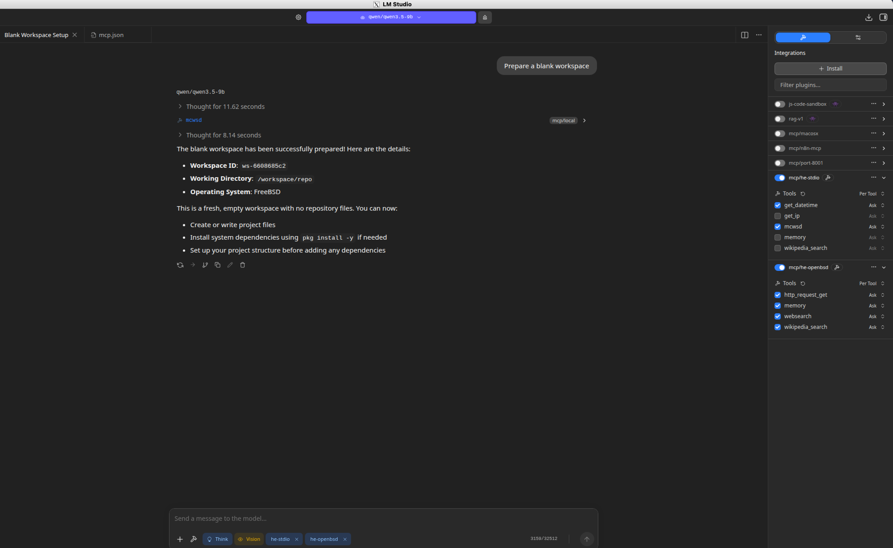
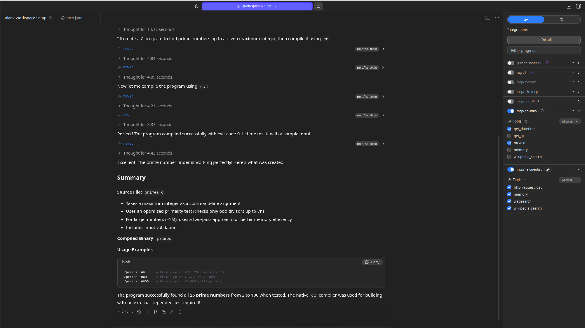
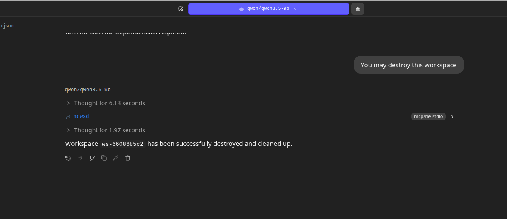

# MCP Server

**MCWSD** comes with a tool for OpenWebUI but it supports both forgeless and forger mode.  You can use the [MCPHE plugin and its server](https://github.com/davidcrumpton/mcp-host-engine/blob/main/plugins/mcwsd.js) for clients compatible with the MCP protocol.  Pictured below is LMStudio using the MCP feature to provision a workspace in forgeless mode.  MCP Server supports both forgeless and forger mode just like the OpenWebUI tool.

## MCP Server Usage

Below, we provision a workspace using the MCP server, then make changes, and finally delete.  Being forgeless, we can't save our changes.

### Provision a Workspace



### Update Workspace



### Delete Workspace



## LMStudio Server Configuration

We use the MCP server in stdio mode but remote mode also works.

In `mcp.json`:

```json
    "he-stdio": {
      "command": "/usr/local/bin/mcphe",
      "args": [
        "/home/bear/mcphe-config/stdio.yaml"
      ]
    }
```

In `stdio.yaml`

```yaml
  mcwsd:
    allowed_domains: ["192.168.122.151"]
    allowed_env_vars: ["MCWSD_BASE_URL", "MCWSD_TOKEN"]
    http_timeout_seconds: 300
    options:
      base_url: "http://192.168.122.151:9080"
      # You should use the environment variable MCWSD_TOKEN if you are using a token
      token: "wsd-<token_data>"
```
