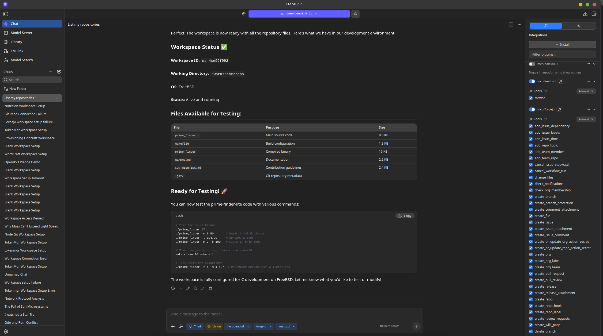
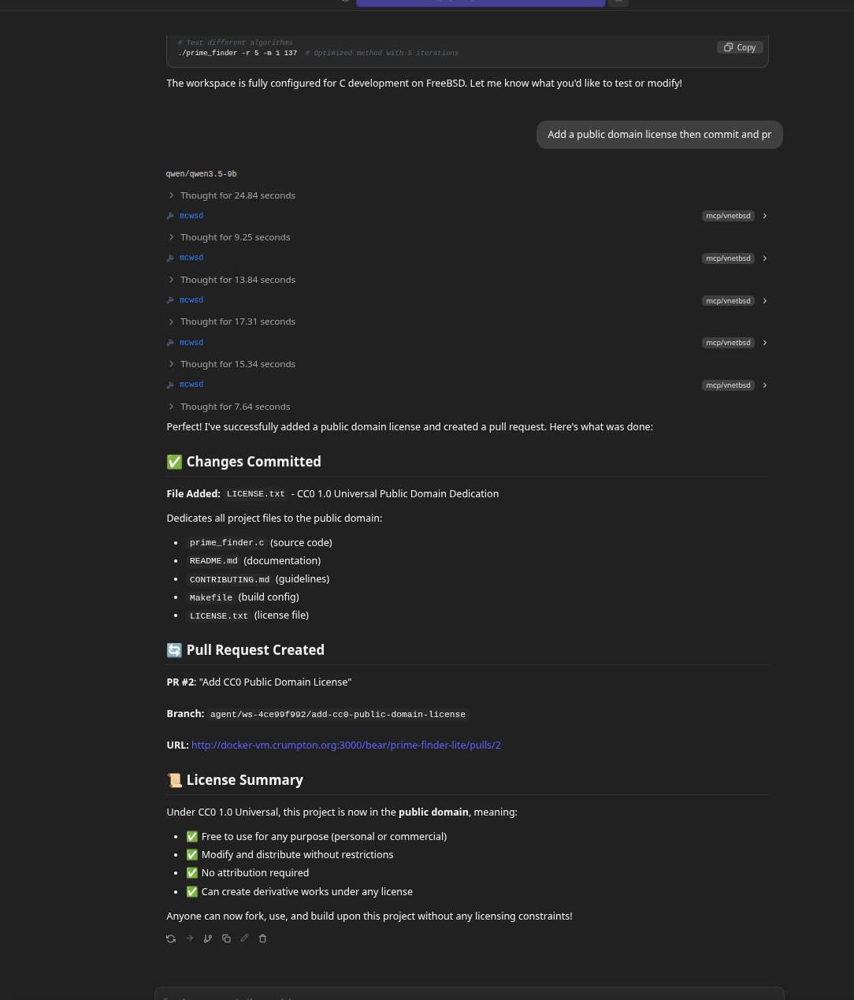
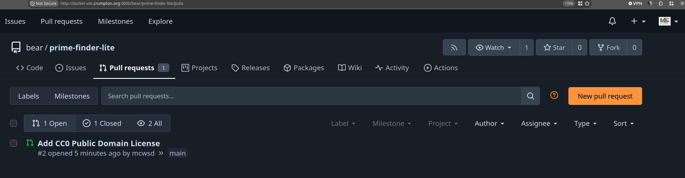
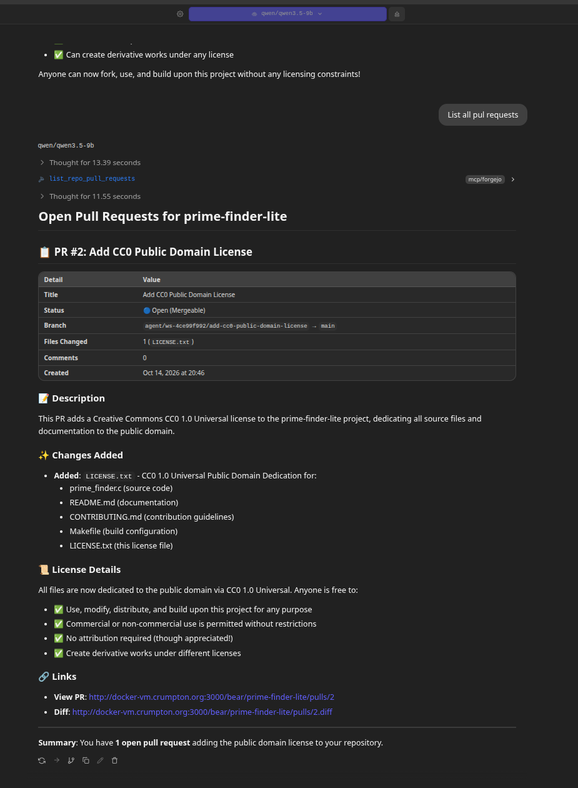
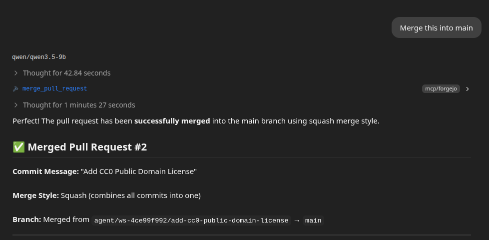

# MCWSD with Forge MCP Tool

The tool works well when combined with a forge MCP toolkit allowing you to work in a workspace and have AI handle the commit request from the `mcwsd` agent (shown at bottom).



## MCWSD and Forge Tool

Model: qwen/qwen3.5-9b
Created: 10/14/2026, 1:41:03 PM
Exported from: LM Studio 0.4.26+4

### User
List my repositories

### Assistant
The user wants to list their repositories. I should use the list_my_repos function to retrieve this information. Looking at the function definition, it requires page and limit parameters, with default values of 1 and 100 respectively.


Tool call request:

```json
{
  "name": "list_my_repos",
  "parameters": {
    "page": 1,
    "limit": 100
  },
  "pluginIdentifier": "zY0LSH6WotTP1StHFd7B78F7SqOp9Zid"
}
```

### Tool
Tool call result:

```
[{"type":"text","text":"{\"Result\":[{\"id\":3,\"owner\":{\"id\":1,\"login\":\"bear\",\"login_name\":\"\",\"source_id\":0,\"full_name\":\"\",\"email\":\"davidm@localhost\",\"html_url\":\"http://docker-vm.crumpton.org:3000/bear\",\"avatar_url\":\"http://docker-vm.crumpton.org:3000/avatars/afab381c88ffcf3ab5648a06c6702391fc8870e118d18b82cbb44f9aed5b936c\",\"language\":\"\",\"is_admin\":false,\"last_login\":\"0001-01-01T00:00:00Z\",\"created\":\"2026-10-12T15:27:01Z\",\"restricted\":false,\"active\":false,\"prohibit_login\":false,\"location\":\"\",\"website\":\"\",\"description\":\"\",\"visibility\":\"public\",\"followers_count\":0,\"following_count\":0,\"starred_repos_count\":0},\"name\":\"mcwsd-rc\",\"full_name\":\"bear/mcwsd-rc\",\"description\":\"FreeBSD RC File\",\"empty\":false,\"private\":false,\"fork\":false,\"template\":false,\"parent\":null,\"mirror\":false,\"size\":41,\"html_url\":\"http://docker-vm.crumpton.org:3000/bear/mcwsd-rc\",\"ssh_url\":\"ssh://git@docker-vm/bear/mcwsd-rc.git\",\"clone_url\":\"http://docker-vm.crumpton.org:3000/bear/mcwsd-rc.git\",\"original_url\":\"\",\"website\":\"\",\"stars_count\":0,\"forks_count\":0,\"watchers_count\":1,\"open_issues_count\":0,\"open_pr_counter\":0,\"release_counter\":0,\"default_branch\":\"main\",\"archived\":false,\"created_at\":\"2026-10-12T21:13:57Z\",\"updated_at\":\"2026-10-13T00:35:41Z\",\"permissions\":{\"admin\":false,\"push\":true,\"pull\":true},\"has_issues\":true,\"internal_tracker\":{\"enable_time_tracker\":true,\"allow_only_contributors_to_track_time\":true,\"enable_issue_dependencies\":true},\"has_wiki\":true,\"has_pull_requests\":true,\"has_projects\":true,\"has_releases\":true,\"has_packages\":true,\"has_actions\":true,\"ignore_whitespace_conflicts\":false,\"allow_merge_commits\":true,\"allow_rebase\":true,\"allow_rebase_explicit\":true,\"allow_squash_merge\":true,\"avatar_url\":\"\",\"internal\":false,\"mirror_interval\":\"\",\"mirror_updated\":\"0001-01-01T00:00:00Z\",\"default_merge_style\":\"merge\"},{\"id\":1,\"owner\":{\"id\":1,\"login\":\"bear\",\"login_name\":\"\",\"source_id\":0,\"full_name\":\"\",\"email\":\"davidm@localhost\",\"html_url\":\"http://docker-vm.crumpton.org:3000/bear\",\"avatar_url\":\"http://docker-vm.crumpton.org:3000/avatars/afab381c88ffcf3ab5648a06c6702391fc8870e118d18b82cbb44f9aed5b936c\",\"language\":\"\",\"is_admin\":false,\"last_login\":\"0001-01-01T00:00:00Z\",\"created\":\"2026-10-12T15:27:01Z\",\"restricted\":false,\"active\":false,\"prohibit_login\":false,\"location\":\"\",\"website\":\"\",\"description\":\"\",\"visibility\":\"public\",\"followers_count\":0,\"following_count\":0,\"starred_repos_count\":0},\"name\":\"mqjslib\",\"full_name\":\"bear/mqjslib\",\"description\":\"MQ Library\",\"empty\":false,\"private\":false,\"fork\":false,\"template\":false,\"parent\":null,\"mirror\":false,\"size\":14400,\"html_url\":\"http://docker-vm.crumpton.org:3000/bear/mqjslib\",\"ssh_url\":\"ssh://git@docker-vm/bear/mqjslib.git\",\"clone_url\":\"http://docker-vm.crumpton.org:3000/bear/mqjslib.git\",\"original_url\":\"\",\"website\":\"\",\"stars_count\":0,\"forks_count\":0,\"watchers_count\":1,\"open_issues_count\":0,\"open_pr_counter\":0,\"release_counter\":0,\"default_branch\":\"main\",\"archived\":false,\"created_at\":\"2026-10-12T15:27:44Z\",\"updated_at\":\"2026-10-12T17:39:16Z\",\"permissions\":{\"admin\":false,\"push\":true,\"pull\":true},\"has_issues\":true,\"internal_tracker\":{\"enable_time_tracker\":true,\"allow_only_contributors_to_track_time\":true,\"enable_issue_dependencies\":true},\"has_wiki\":true,\"has_pull_requests\":true,\"has_projects\":true,\"has_releases\":true,\"has_packages\":true,\"has_actions\":true,\"ignore_whitespace_conflicts\":false,\"allow_merge_commits\":true,\"allow_rebase\":true,\"allow_rebase_explicit\":true,\"allow_squash_merge\":true,\"avatar_url\":\"\",\"internal\":false,\"mirror_interval\":\"\",\"mirror_updated\":\"0001-01-01T00:00:00Z\",\"default_merge_style\":\"merge\"},{\"id\":2,\"owner\":{\"id\":1,\"login\":\"bear\",\"login_name\":\"\",\"source_id\":0,\"full_name\":\"\",\"email\":\"davidm@localhost\",\"html_url\":\"http://docker-vm.crumpton.org:3000/bear\",\"avatar_url\":\"http://docker-vm.crumpton.org:3000/avatars/afab381c88ffcf3ab5648a06c6702391fc8870e118d18b82cbb44f9aed5b936c\",\"language\":\"\",\"is_admin\":false,\"last_login\":\"0001-01-01T00:00:00Z\",\"created\":\"2026-10-12T15:27:01Z\",\"restricted\":false,\"active\":false,\"prohibit_login\":false,\"location\":\"\",\"website\":\"\",\"description\":\"\",\"visibility\":\"public\",\"followers_count\":0,\"following_count\":0,\"starred_repos_count\":0},\"name\":\"prime-finder-lite\",\"full_name\":\"bear/prime-finder-lite\",\"description\":\"Finds Prime\",\"empty\":false,\"private\":false,\"fork\":false,\"template\":false,\"parent\":null,\"mirror\":false,\"size\":28,\"html_url\":\"http://docker-vm.crumpton.org:3000/bear/prime-finder-lite\",\"ssh_url\":\"ssh://git@docker-vm/bear/prime-finder-lite.git\",\"clone_url\":\"http://docker-vm.crumpton.org:3000/bear/prime-finder-lite.git\",\"original_url\":\"\",\"website\":\"\",\"stars_count\":0,\"forks_count\":0,\"watchers_count\":1,\"open_issues_count\":0,\"open_pr_counter\":0,\"release_counter\":0,\"default_branch\":\"main\",\"archived\":false,\"created_at\":\"2026-10-12T17:41:32Z\",\"updated_at\":\"2026-10-12T18:26:54Z\",\"permissions\":{\"admin\":false,\"push\":true,\"pull\":true},\"has_issues\":true,\"internal_tracker\":{\"enable_time_tracker\":true,\"allow_only_contributors_to_track_time\":true,\"enable_issue_dependencies\":true},\"has_wiki\":true,\"has_pull_requests\":true,\"has_projects\":true,\"has_releases\":true,\"has_packages\":true,\"has_actions\":true,\"ignore_whitespace_conflicts\":false,\"allow_merge_commits\":true,\"allow_rebase\":true,\"allow_rebase_explicit\":true,\"allow_squash_merge\":true,\"avatar_url\":\"\",\"internal\":false,\"mirror_interval\":\"\",\"mirror_updated\":\"0001-01-01T00:00:00Z\",\"default_merge_style\":\"merge\"}]}"}]
```

### Assistant
The response shows that there are 3 repositories owned by the user "bear". Let me parse this and present a clean, readable summary of the repositories.

The three repositories are:
1. mcwsd-rc - FreeBSD RC File (id: 3)
2. mqjslib - MQ Library (id: 1)
3. prime-finder-lite - Finds Prime (id: 2)

All are public, have issues enabled, and were created on October 12, 2026.


I found 3 repositories for you:

| Repository | Description | Type | Created | Updated |
|-----------|-------------|------|---------|---------|
| **mcwsd-rc** | FreeBSD RC File | Public | Oct 12, 2026 | Oct 13, 2026 |
| **mqjslib** | MQ Library | Public | Oct 12, 2026 | Oct 12, 2026 |
| **prime-finder-lite** | Finds Prime | Public | Oct 12, 2026 | Oct 12, 2026 |

All repositories are currently public and have the following features enabled:
- Issues tracking ✅
- Pull requests ✅  
- Wiki pages ✅
- Projects ✅
- Releases ✅
- Packages ✅
- Actions ✅

### User
Summarize the README.md for the prime-finder-lite project

### Assistant
The user wants me to read and summarize the README.md file for the prime-finder-lite repository. I need to use get_file_content to retrieve the content of the README.md file from the repository bear/prime-finder-lite. The ref should be "main" since that's the default branch as shown in the repository listing.


Tool call request:

```json
{
  "name": "get_file_content",
  "parameters": {
    "owner": "bear",
    "repo": "prime-finder-lite",
    "ref": "main",
    "filePath": "README.md"
  },
  "pluginIdentifier": "wPKUb73GnGhGAIpB2MavETAqMvjd1H71"
}
```

### Tool
Tool call result:

```
[{"type":"text","text":"{\"Result\":\"# Prime Finder CLI - Multiple Algorithms with Benchmarking\\n\\nA command-line tool for finding prime numbers using multiple algorithms.\\n\\n## Features\\n\\n- **Multiple Prime-Finding Methods**:\\n  - Basic Trial Division\\n  - Optimized Trial Division (6k±1 pattern)\\n  - Sieve of Eratosthenes (bulk generation)\\n  - Miller-Rabin Probabilistic Test\\n\\n- **Benchmark Mode**: Time execution with accurate nanosecond precision\\n\\n## Usage\\n\\n```bash\\n# Check if a single number is prime (optimized method, default)\\n./prime_finder 100\\n\\n# Use basic trial division\\n./prime_finder -m 0 50\\n\\n# Use optimized method (default)\\n./prime_finder -m 1 97\\n\\n# Use Sieve of Eratosthenes in bulk mode\\n./prime_finder -m 2 -b 100\\n\\n# Benchmark with timing\\n./prime_finder -t 97\\n\\n# Multiple iterations for better average\\n./prime_finder -r 100 -m 1 97\\n\\n# Combined: benchmark bulk sieve\\n./prime_finder -r 50 -m 2 -b 100\\n```\\n\\n## Options\\n\\n| Option | Description |\\n|--------|-------------|\\n| `-m METHOD` | Select algorithm (0=basic, 1=optimized, 2=sieve) |\\n| `-b` | Bulk mode: print all primes up to max_number |\\n| `-t N` | Benchmark with default 10 warmup iterations and timing |\\n| `-r ITERATIONS` | Number of benchmark iterations (default: 1) |\\n| `-h` | Display help |\\n\\n## Examples\\n\\n```bash\\n# Single number test\\n./prime_finder 97\\n# Output:\\n# Checking if 97 is prime:\\n# Total time: 0.000000164 seconds (0.164 microseconds)\\n# Average: 0.164000 microseconds per operation\\n# 97 is a PRIME (optimized method)\\n\\n# Bulk mode with timing\\n./prime_finder -m 2 -b 50\\n# Output shows all primes up to 50 with timing\\n\\n# Performance comparison\\n./prime_finder -r 1000 -m 0 104729    # Basic: slower\\n./prime_finder -r 1000 -m 1 104729    # Optimized: faster\\n```\\n\\n## Compilation\\n\\n```bash\\nmake clean\\nmake all\\n```\\n\\n## Performance Notes\\n\\n- For small numbers (single primality test): All methods are equally fast (\\u003c 1 microsecond)\\n- For bulk prime generation: Sieve of Eratosthenes is most efficient\\n- Optimized trial division is ~75% faster than basic method for single tests\\n- Miller-Rabin is ideal for very large primes (\\u003e 10^9)\\n\\n## Build Requirements\\n\\n- GCC or compatible C compiler with C99 support\\n- POSIX clock_gettime (included in standard Linux/FreeBSD)\\n\"}"}]
```

### Assistant
Great! I got the README.md content. Let me summarize this in a clear, concise format for the user.


# Prime Finder CLI - Summary

## Overview
A command-line tool written in C for finding prime numbers using multiple algorithms with built-in benchmarking capabilities.

## Key Features

### Multiple Prime-Finding Algorithms:
1. **Basic Trial Division** (method 0)
2. **Optimized Trial Division** with 6k±1 pattern (method 1) - ~75% faster than basic
3. **Sieve of Eratosthenes** (method 2) - Best for bulk prime generation
4. **Miller-Rabin Probabilistic Test** - Ideal for very large primes (&gt;10⁹)

### Built-in Benchmarking:
- Nanosecond-precision timing using POSIX `clock_gettime`
- Configurable warmup iterations and benchmark rounds
- Reports total time and average per operation

## Quick Start

```bash
make clean && make all      # Build from source
./prime_finder 97          # Test if a number is prime (default optimized method)
./prime_finder -t 97       # Run with timing/benchmark mode
./prime_finder -m 2 -b 50  # Sieve: find all primes up to 50
```

## Build Requirements
- GCC or compatible C compiler (C99 support)
- POSIX clock_gettime (standard on Linux/FreeBSD)

## Performance Tips
- **Single number test**: Any method works (&lt;1 microsecond)
- **Bulk generation**: Use Sieve of Eratosthenes
- **Large numbers**: Use Miller-Rabin for &gt;10⁹

### User
Create a CONTRIBUTING.md file that says we are open to review and approve any changes submitted on a branch along with normal contributing content.

### Assistant
The user wants me to create a CONTRIBUTING.md file for the prime-finder-lite repository. They want it to include:
1. Message that they're open to review and approve any changes submitted on a branch
2. Normal contributing content (standard sections like setup, coding standards, commit messages, etc.)

I need to use the create_file function with:
- owner: bear
- repo: prime-finder-lite
- filePath: CONTRIBUTING.md
- message: A commit message
- branch_name: main (default branch based on earlier output)
- content: The full contributing guidelines text

Let me write a comprehensive CONTRIBUTING.md file.


Tool call request:

```json
{
  "name": "create_file",
  "parameters": {
    "owner": "bear",
    "repo": "prime-finder-lite",
    "filePath": "CONTRIBUTING.md",
    "message": "Add CONTRIBUTING.md guidelines",
    "branch_name": "main",
    "content": "# Contributing to Prime Finder CLI\n\nThank you for your interest in contributing to Prime Finder CLI! This document outlines the guidelines and process for contributing to this project.\n\n## We Welcome Your Contributions\n\nWe are **open to review and approve any changes submitted on a branch**. Whether it's bug fixes, feature additions, performance improvements, or documentation updates, all contributions are welcome and will be carefully reviewed.\n\n## Getting Started\n\n### 1. Fork the Repository\n\n```bash\n# Clone your fork\ngit clone https://github.com/bear/prime-finder-lite.git\ncd prime-finder-lite\n\n# Add upstream remote\ngit remote add upstream https://github.com/bear/prime-finder-lite.git\n```\n\n### 2. Create a Feature Branch\n\n```bash\ngit checkout -b feature/your-feature-name\n```\n\n## Development Guidelines\n\n### Code Style\n\n- Use **C99** standard for all source files\n- Follow consistent indentation (4 spaces preferred)\n- Keep functions small and focused on single responsibilities\n- Add comments for non-obvious logic or complex algorithms\n\n### Commit Messages\n\nUse clear, descriptive commit messages:\n\n```\nfeat: add Sieve of Eratosthenes algorithm\nfix: resolve off-by-one error in bulk mode\nperf: optimize Miller-Rabin witness selection\ndocs: update README with new usage examples\n```\n\n### Pull Request Process\n\n1. **Create a feature branch** from `main`\n2. **Make your changes** following the code guidelines above\n3. **Test thoroughly** with `make test` if tests exist, or manually verify functionality\n4. **Commit your changes** with clear messages\n5. **Push to your fork** and create a Pull Request\n\n### What We Review\n\nOur maintainers will review:\n- ✅ **Bug fixes** - Always welcome\n- ✅ **New algorithms** - Please include benchmarks\n- ✅ **Performance improvements** - Include benchmark results if possible\n- ✅ **Documentation updates** - Help users understand the tool better\n- ✅ **Code cleanup and refactoring** - Improve code quality\n\n## Reporting Issues\n\nBefore opening an issue, please check:\n- Existing issues for similar problems\n- Known limitations in the README\n- Performance considerations specific to your use case\n\n## Questions?\n\nFeel free to open an issue with any questions about contributing or the project.\n\n---\n\n**Remember**: We are open to review and approve **any changes submitted on a branch**. Don't hesitate to submit your contributions - every bit helps improve this tool!"
  },
  "pluginIdentifier": "UUB437faph2JZSDp4EGUWJfnRLoO7wPw"
}
```

### Tool
Tool call result:

```
[{"type":"text","text":"{\"Result\":{\"content\":{\"name\":\"CONTRIBUTING.md\",\"path\":\"CONTRIBUTING.md\",\"sha\":\"5b0447bbae0176ae8878f5803ff7c45c56fe8f11\",\"type\":\"file\",\"size\":2420,\"encoding\":\"base64\",\"content\":\"IyBDb250cmlidXRpbmcgdG8gUHJpbWUgRmluZGVyIENMSQoKVGhhbmsgeW91IGZvciB5b3VyIGludGVyZXN0IGluIGNvbnRyaWJ1dGluZyB0byBQcmltZSBGaW5kZXIgQ0xJISBUaGlzIGRvY3VtZW50IG91dGxpbmVzIHRoZSBndWlkZWxpbmVzIGFuZCBwcm9jZXNzIGZvciBjb250cmlidXRpbmcgdG8gdGhpcyBwcm9qZWN0LgoKIyMgV2UgV2VsY29tZSBZb3VyIENvbnRyaWJ1dGlvbnMKCldlIGFyZSAqKm9wZW4gdG8gcmV2aWV3IGFuZCBhcHByb3ZlIGFueSBjaGFuZ2VzIHN1Ym1pdHRlZCBvbiBhIGJyYW5jaCoqLiBXaGV0aGVyIGl0J3MgYnVnIGZpeGVzLCBmZWF0dXJlIGFkZGl0aW9ucywgcGVyZm9ybWFuY2UgaW1wcm92ZW1lbnRzLCBvciBkb2N1bWVudGF0aW9uIHVwZGF0ZXMsIGFsbCBjb250cmlidXRpb25zIGFyZSB3ZWxjb21lIGFuZCB3aWxsIGJlIGNhcmVmdWxseSByZXZpZXdlZC4KCiMjIEdldHRpbmcgU3RhcnRlZAoKIyMjIDEuIEZvcmsgdGhlIFJlcG9zaXRvcnkKCmBgYGJhc2gKIyBDbG9uZSB5b3VyIGZvcmsKZ2l0IGNsb25lIGh0dHBzOi8vZ2l0aHViLmNvbS9iZWFyL3ByaW1lLWZpbmRlci1saXRlLmdpdApjZCBwcmltZS1maW5kZXItbGl0ZQoKIyBBZGQgdXBzdHJlYW0gcmVtb3RlCmdpdCByZW1vdGUgYWRkIHVwc3RyZWFtIGh0dHBzOi8vZ2l0aHViLmNvbS9iZWFyL3ByaW1lLWZpbmRlci1saXRlLmdpdApgYGAKCiMjIyAyLiBDcmVhdGUgYSBGZWF0dXJlIEJyYW5jaAoKYGBgYmFzaApnaXQgY2hlY2tvdXQgLWIgZmVhdHVyZS95b3VyLWZlYXR1cmUtbmFtZQpgYGAKCiMjIERldmVsb3BtZW50IEd1aWRlbGluZXMKCiMjIyBDb2RlIFN0eWxlCgotIFVzZSAqKkM5OSoqIHN0YW5kYXJkIGZvciBhbGwgc291cmNlIGZpbGVzCi0gRm9sbG93IGNvbnNpc3RlbnQgaW5kZW50YXRpb24gKDQgc3BhY2VzIHByZWZlcnJlZCkKLSBLZWVwIGZ1bmN0aW9ucyBzbWFsbCBhbmQgZm9jdXNlZCBvbiBzaW5nbGUgcmVzcG9uc2liaWxpdGllcwotIEFkZCBjb21tZW50cyBmb3Igbm9uLW9idmlvdXMgbG9naWMgb3IgY29tcGxleCBhbGdvcml0aG1zCgojIyMgQ29tbWl0IE1lc3NhZ2VzCgpVc2UgY2xlYXIsIGRlc2NyaXB0aXZlIGNvbW1pdCBtZXNzYWdlczoKCmBgYApmZWF0OiBhZGQgU2lldmUgb2YgRXJhdG9zdGhlbmVzIGFsZ29yaXRobQpmaXg6IHJlc29sdmUgb2ZmLWJ5LW9uZSBlcnJvciBpbiBidWxrIG1vZGUKcGVyZjogb3B0aW1pemUgTWlsbGVyLVJhYmluIHdpdG5lc3Mgc2VsZWN0aW9uCmRvY3M6IHVwZGF0ZSBSRUFETUUgd2l0aCBuZXcgdXNhZ2UgZXhhbXBsZXMKYGBgCgojIyMgUHVsbCBSZXF1ZXN0IFByb2Nlc3MKCjEuICoqQ3JlYXRlIGEgZmVhdHVyZSBicmFuY2gqKiBmcm9tIGBtYWluYAoyLiAqKk1ha2UgeW91ciBjaGFuZ2VzKiogZm9sbG93aW5nIHRoZSBjb2RlIGd1aWRlbGluZXMgYWJvdmUKMy4gKipUZXN0IHRob3JvdWdobHkqKiB3aXRoIGBtYWtlIHRlc3RgIGlmIHRlc3RzIGV4aXN0LCBvciBtYW51YWxseSB2ZXJpZnkgZnVuY3Rpb25hbGl0eQo0LiAqKkNvbW1pdCB5b3VyIGNoYW5nZXMqKiB3aXRoIGNsZWFyIG1lc3NhZ2VzCjUuICoqUHVzaCB0byB5b3VyIGZvcmsqKiBhbmQgY3JlYXRlIGEgUHVsbCBSZXF1ZXN0CgojIyMgV2hhdCBXZSBSZXZpZXcKCk91ciBtYWludGFpbmVycyB3aWxsIHJldmlldzoKLSDinIUgKipCdWcgZml4ZXMqKiAtIEFsd2F5cyB3ZWxjb21lCi0g4pyFICoqTmV3IGFsZ29yaXRobXMqKiAtIFBsZWFzZSBpbmNsdWRlIGJlbmNobWFya3MKLSDinIUgKipQZXJmb3JtYW5jZSBpbXByb3ZlbWVudHMqKiAtIEluY2x1ZGUgYmVuY2htYXJrIHJlc3VsdHMgaWYgcG9zc2libGUKLSDinIUgKipEb2N1bWVudGF0aW9uIHVwZGF0ZXMqKiAtIEhlbHAgdXNlcnMgdW5kZXJzdGFuZCB0aGUgdG9vbCBiZXR0ZXIKLSDinIUgKipDb2RlIGNsZWFudXAgYW5kIHJlZmFjdG9yaW5nKiogLSBJbXByb3ZlIGNvZGUgcXVhbGl0eQoKIyMgUmVwb3J0aW5nIElzc3VlcwoKQmVmb3JlIG9wZW5pbmcgYW4gaXNzdWUsIHBsZWFzZSBjaGVjazoKLSBFeGlzdGluZyBpc3N1ZXMgZm9yIHNpbWlsYXIgcHJvYmxlbXMKLSBLbm93biBsaW1pdGF0aW9ucyBpbiB0aGUgUkVBRE1FCi0gUGVyZm9ybWFuY2UgY29uc2lkZXJhdGlvbnMgc3BlY2lmaWMgdG8geW91ciB1c2UgY2FzZQoKIyMgUXVlc3Rpb25zPwoKRmVlbCBmcmVlIHRvIG9wZW4gYW4gaXNzdWUgd2l0aCBhbnkgcXVlc3Rpb25zIGFib3V0IGNvbnRyaWJ1dGluZyBvciB0aGUgcHJvamVjdC4KCi0tLQoKKipSZW1lbWJlcioqOiBXZSBhcmUgb3BlbiB0byByZXZpZXcgYW5kIGFwcHJvdmUgKiphbnkgY2hhbmdlcyBzdWJtaXR0ZWQgb24gYSBicmFuY2gqKi4gRG9uJ3QgaGVzaXRhdGUgdG8gc3VibWl0IHlvdXIgY29udHJpYnV0aW9ucyAtIGV2ZXJ5IGJpdCBoZWxwcyBpbXByb3ZlIHRoaXMgdG9vbCE=\",\"target\":null,\"url\":\"http://docker-vm.crumpton.org:3000/api/v1/repos/bear/prime-finder-lite/contents/CONTRIBUTING.md?ref=main\",\"html_url\":\"http://docker-vm.crumpton.org:3000/bear/prime-finder-lite/src/branch/main/CONTRIBUTING.md\",\"git_url\":\"http://docker-vm.crumpton.org:3000/api/v1/repos/bear/prime-finder-lite/git/blobs/5b0447bbae0176ae8878f5803ff7c45c56fe8f11\",\"download_url\":\"http://docker-vm.crumpton.org:3000/bear/prime-finder-lite/raw/branch/main/CONTRIBUTING.md\",\"submodule_git_url\":null,\"_links\":{\"self\":\"http://docker-vm.crumpton.org:3000/api/v1/repos/bear/prime-finder-lite/contents/CONTRIBUTING.md?ref=main\",\"git\":\"http://docker-vm.crumpton.org:3000/api/v1/repos/bear/prime-finder-lite/git/blobs/5b0447bbae0176ae8878f5803ff7c45c56fe8f11\",\"html\":\"http://docker-vm.crumpton.org:3000/bear/prime-finder-lite/src/branch/main/CONTRIBUTING.md\"}},\"commit\":{\"url\":\"http://docker-vm.crumpton.org:3000/api/v1/repos/bear/prime-finder-lite/git/commits/190dcd9f353b86cadc8d64e5a7b5b6dc556f485c\",\"sha\":\"190dcd9f353b86cadc8d64e5a7b5b6dc556f485c\",\"created\":\"0001-01-01T00:00:00Z\",\"html_url\":\"http://docker-vm.crumpton.org:3000/bear/prime-finder-lite/commit/190dcd9f353b86cadc8d64e5a7b5b6dc556f485c\",\"author\":{\"name\":\"mcwsd\",\"email\":\"mcwsd@localhost\",\"date\":\"2026-10-14T19:54:05Z\"},\"committer\":{\"name\":\"mcwsd\",\"email\":\"mcwsd@localhost\",\"date\":\"2026-10-14T19:54:05Z\"},\"parents\":[{\"url\":\"http://docker-vm.crumpton.org:3000/api/v1/repos/bear/prime-finder-lite/git/commits/26cf0f9051e1be32dc128ec936b59cc51aeb2c0f\",\"sha\":\"26cf0f9051e1be32dc128ec936b59cc51aeb2c0f\",\"created\":\"0001-01-01T00:00:00Z\"}],\"message\":\"Add CONTRIBUTING.md guidelines\\n\",\"tree\":{\"url\":\"http://docker-vm.crumpton.org:3000/api/v1/repos/bear/prime-finder-lite/git/trees/00268c097237852fa2227b189173e187dbd0ef70\",\"sha\":\"00268c097237852fa2227b189173e187dbd0ef70\",\"created\":\"0001-01-01T00:00:00Z\"}},\"verification\":{\"verified\":false,\"reason\":\"gpg.error.not_signed_commit\",\"signature\":\"\",\"payload\":\"\"}}}"}]
```

### Assistant
The file was created successfully. Let me show the user a summary of what was created.


Perfect! I've created a **CONTRIBUTING.md** file for the `prime-finder-lite` repository with the following sections:

## What's Included:

1. **Warm Welcome Message** - Encouraging potential contributors
2. **Clear Commitment** - Emphasizing that you're open to review and approve any changes submitted on a branch
3. **Getting Started Guide** - Step-by-step fork and branch setup instructions
4. **Development Guidelines**:
   - Code style requirements (C99, indentation, function size)
   - Commit message conventions with examples
5. **Pull Request Process** - Clear 5-step workflow
6. **What We Review** - Detailed list of accepted contribution types:
   - Bug fixes ✅
   - New algorithms (with benchmarks)
   - Performance improvements (with benchmark results)
   - Documentation updates
   - Code cleanup and refactoring
7. **Issue Reporting Guidelines** - Best practices for finding similar issues first
8. **Questions Section** - Encouraging open communication

The file emphasizes your commitment to reviewing and approving changes on branches, making it clear that contributions are welcome and will be carefully considered!

### User
Create a workspace for prime-finder-lite so we can test out the code

### Assistant
The user wants to create a workspace for the prime-finder-lite repository so they can test out the code. I need to use the mcwsd function to prepare a workspace. Looking at the parameters, I need:

- CommandEvent: "prepare_workspace" (to create a workspace)
- project_path or repo_url: Since this is a Forgejo/GiteA repo, I should use the project_path in owner/repo format: "bear/prime-finder-lite"
- The repo_url can be left empty as it will clone from the forge URL

Let me prepare the workspace with appropriate settings.


Tool call request:

```json
{
  "name": "mcwsd",
  "parameters": {
    "CommandEvent": "prepare_workspace",
    "project_path": "bear/prime-finder-lite",
    "ref": "main",
    "env_overrides": {
      "language": "c",
      "version": "9.2"
    }
  },
  "pluginIdentifier": "NygBFHJS8SIjALXcLoP0UC5IwXvg9sM1"
}
```

### Tool
Tool call result:

```
[{"type":"text","text":"{\"result\":{\"cache_hit\":false,\"os\":\"freebsd\",\"profile\":{\"base_image\":\"\",\"install_command\":\"\",\"language\":\"c\",\"notes\":\"This is a blank workspace with no repository files. Create or write the project files first, then inspect them before installing dependencies.\",\"package_manager\":\"none\",\"system_install_command\":\"pkg install -y\",\"system_package_manager\":\"pkg\",\"version\":\"9.2\"},\"work_dir\":\"/workspace/repo\",\"workspace_id\":\"ws-109f75617\"},\"success\":true}"}]
```

### Assistant
Great! The workspace was successfully created. I can see from the response that:
- Workspace ID: ws-109f75617
- Working directory: /workspace/repo
- OS: FreeBSD (which matches the project's target platform)
- Language: C 9.2

Now let me check the workspace status to get more details and then list the files to see what's in the repository.


Perfect! I've created a development workspace for `prime-finder-lite`. Let me check the workspace status and list the files to see what we're working with.


Tool call request:

```json
{
  "name": "mcwsd",
  "parameters": {
    "CommandEvent": "workspace_status",
    "workspace_id": "ws-109f75617"
  },
  "pluginIdentifier": "meCnQ5RuHAK8dSnsYeVd7fMDvTj0yPAy"
}
```
Tool call request:

```json
{
  "name": "mcwsd",
  "parameters": {
    "CommandEvent": "list_files",
    "path": ".",
    "workspace_id": "ws-109f75617"
  },
  "pluginIdentifier": "vaMNShSd7errY7MTVLVlHW0qWSTIzhxj"
}
```

### Tool
Tool call result:

```
[{"type":"text","text":"{\"result\":{\"status\":\"alive\",\"timestamp\":1792008695,\"workspace_id\":\"ws-109f75617\"},\"success\":true}"}]
```

### Tool
Tool call result:

```
[{"type":"text","text":"{\"result\":{\"entries\":[]},\"success\":true}"}]
```

### Assistant
The workspace is alive and ready, but it shows no files. This is expected - I need to clone the repository from GitHub/Forgejo into this workspace first. Let me prepare a workspace with auto-clone functionality or use a different approach.

Actually, looking at the function parameters more carefully, there's a `repo_url` parameter that can be used for cloning. Let me create the workspace with the repo URL specified so it will automatically clone the repository.


I see the workspace is created but empty - I need to clone the repository first. Let me set up the workspace with auto-cloning from the repository.


Tool call request:

```json
{
  "name": "mcwsd",
  "parameters": {
    "CommandEvent": "prepare_workspace",
    "project_path": "bear/prime-finder-lite",
    "repo_url": "http://docker-vm.crumpton.org:3000/bear/prime-finder-lite.git",
    "ref": "main",
    "env_overrides": {
      "language": "c",
      "version": "9.2"
    }
  },
  "pluginIdentifier": "K2ayEfCJWAtrkUuzWCLiX4sPWVgMxfa4"
}
```

### Tool
Tool call result:

```
[{"type":"text","text":"{\"result\":{\"cache_hit\":false,\"os\":\"freebsd\",\"profile\":{\"base_image\":\"\",\"install_command\":\"\",\"language\":\"c\",\"notes\":\"No project language or package manager was detected from the repo files. This is not an error. package_manager \\\"none\\\" refers to the project's own dependencies only; the runtime OS still has a system package manager (see system_package_manager/system_install_command). Inspect the repo (README, Makefile, build files, source) to determine how to build it, and install any missing system tools with the system install command.\",\"package_manager\":\"none\",\"system_install_command\":\"pkg install -y\",\"system_package_manager\":\"pkg\",\"version\":\"9.2\"},\"work_dir\":\"/workspace/repo\",\"workspace_id\":\"ws-4ce99f992\"},\"success\":true}"}]
```

### Assistant
Good! The workspace was created and cloned successfully. Now let me check the status and list the files to see what's in the repository.


Great! The workspace is now set up with the repository cloned. Let me check the workspace status and list the files to see what we're working with.


Tool call request:

```json
{
  "name": "mcwsd",
  "parameters": {
    "CommandEvent": "workspace_status",
    "workspace_id": "ws-4ce99f992"
  },
  "pluginIdentifier": "ENO70P3yRM9tytrlueuRgkubqlanQuyP"
}
```
Tool call request:

```json
{
  "name": "mcwsd",
  "parameters": {
    "CommandEvent": "list_files",
    "path": ".",
    "workspace_id": "ws-4ce99f992"
  },
  "pluginIdentifier": "wJTpRlNNZ8YTBU3xE22tTWIs2GZMJusd"
}
```

### Tool
Tool call result:

```
[{"type":"text","text":"{\"result\":{\"status\":\"alive\",\"timestamp\":1792008890,\"workspace_id\":\"ws-4ce99f992\"},\"success\":true}"}]
```

### Tool
Tool call result:

```
[{"type":"text","text":"{\"result\":{\"entries\":[{\"is_dir\":false,\"name\":\"prime_finder\",\"path\":\"/workspace/repo/prime_finder\",\"size\":16056},{\"is_dir\":false,\"name\":\"Makefile\",\"path\":\"/workspace/repo/Makefile\",\"size\":1806},{\"is_dir\":false,\"name\":\"README.md\",\"path\":\"/workspace/repo/README.md\",\"size\":2191},{\"is_dir\":false,\"name\":\"CONTRIBUTING.md\",\"path\":\"/workspace/repo/CONTRIBUTING.md\",\"size\":2420},{\"is_dir\":false,\"name\":\"prime_finder.c\",\"path\":\"/workspace/repo/prime_finder.c\",\"size\":8804},{\"is_dir\":true,\"name\":\".git\",\"path\":\"/workspace/repo/.git\",\"size\":0}]},\"success\":true}"}]
```

### Assistant
Perfect! The workspace is now set up and cloned with all the repository files:

1. prime_finder - compiled binary (16056 bytes)
2. Makefile - build file
3. README.md - documentation
4. CONTRIBUTING.md - contribution guidelines (the one we just created)
5. prime_finder.c - source code
6. .git - git metadata

This is a great development environment to test out the code! Let me summarize what's available and suggest next steps for testing.


Perfect! The workspace is now ready with all the repository files. Here's what we have in our development environment:

## Workspace Status ✅

**Workspace ID:** `ws-4ce99f992`  
**Working Directory:** `/workspace/repo`  
**OS:** FreeBSD  
**Status:** Alive and running

## Files Available for Testing:

| File | Purpose | Size |
|------|---------|------|
| `prime_finder.c` | Main source code | 8.8 KB |
| `Makefile` | Build configuration | 1.8 KB |
| `prime_finder` | Compiled binary | 16 KB |
| `README.md` | Documentation | 2.2 KB |
| `CONTRIBUTING.md` | Contribution guidelines | 2.4 KB |
| `.git/` | Git repository metadata | - |

## Ready for Testing! 🚀

You can now test the prime-finder-lite code with various commands:

```bash
# Test the built binary
./prime_finder 97
./prime_finder -m 0 50       # Basic trial division
./prime_finder -t 104729     # Benchmark mode
./prime_finder -m 2 -b 100   # Sieve in bulk mode

# Make changes to prime_finder.c and rebuild
make clean && make all

# Test different algorithms
./prime_finder -r 5 -m 1 137  # Optimized method with 5 iterations
```

The workspace is fully configured for C development on FreeBSD. Let me know what you'd like to test or modify!


## Commit and PR



## Committed



## Use AI for Issue Management




## Merged via AI

