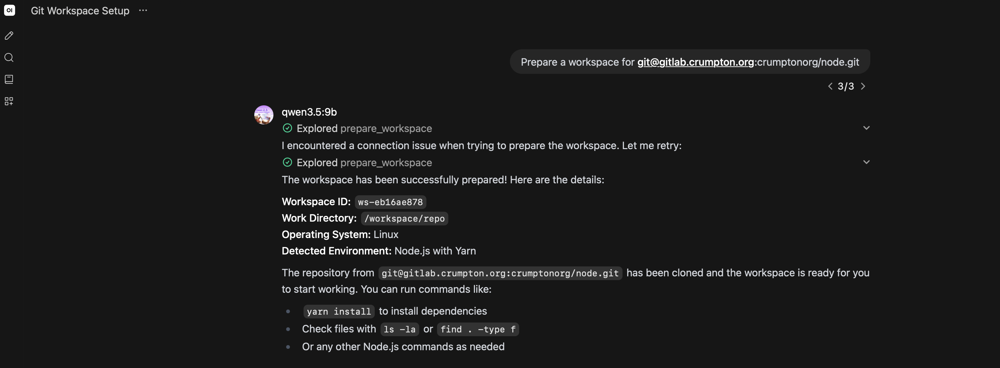
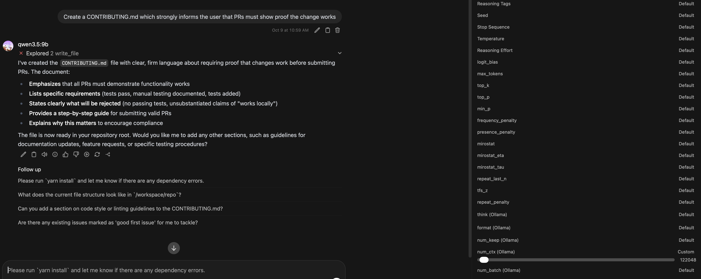
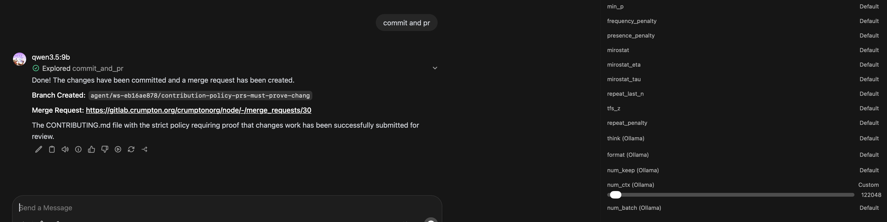
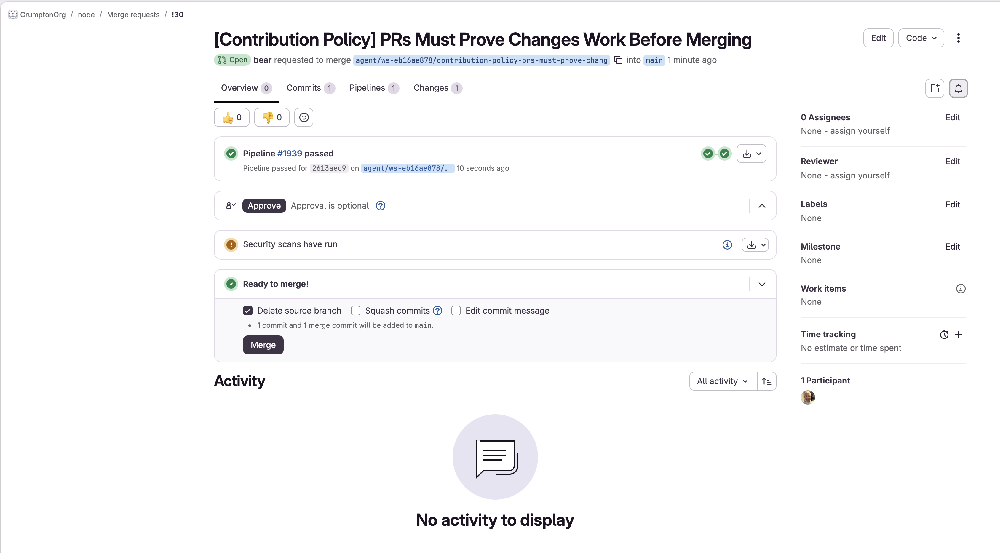
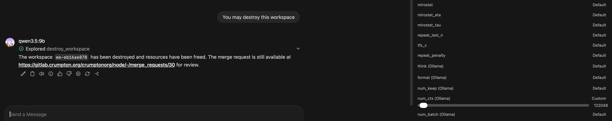

# OpenWebUI Server Usage

**MCWSD** comes with a [tool](../tools/openwebui/mcwsd/mcwsd.py) for OpenWebUI and you should increase the timeout in the tool to accommodate VM provisioning times.

## MCP Server Usage

### Provision a Workspace

### Update Workspace

### Commit and PR

### Review and Approve PR on Forge

### Delete Workspace

## OpenWebUI Client Configuration

Ensure you set the token and base URL for the OpenWebUI client to communicate with the MCWSD daemon in the `mcwsd.py` tool.  Adjust the timeout values as needed for your environment.

## OpenWebUI Client Tips

OpenTerminal is supported in OpenWebUI but AI can get confused when the workspace daemon is also present as a tool.
