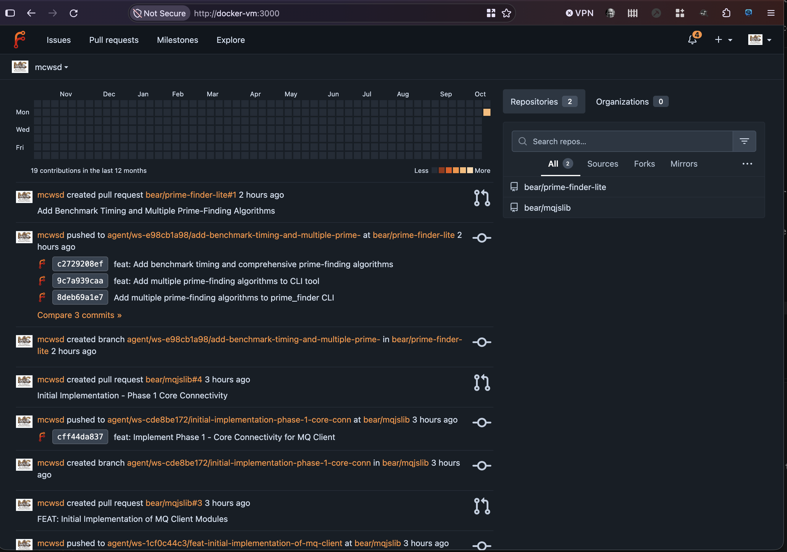

# Token Setup

All of my examples use the Forge with SSH keys which adds additional complexity to the setup.  However, you can use just a token with sufficient permissions.

## Daemon Options

The daemon has fewer and simpler options when forging with just a token.  The `mcwsd` daemon below runs on FreeBSD and is connected to Forgejo.

```text
/usr/local/bin/mcwsd daemon --port 9080 --workspace-base-path /home/wsd --cache-dir /home/wsd/cache --runtime jail --state-file /home/wsd/state.json --forge-type=forgejo --git-auth-mode=token --bind-address=0.0.0.0 --freebsd-network-mode=vnet --freebsd-interface=em0 --jobs-file=/home/wsd/jobs.json --exec-wait-seconds=300 --forgejo-api-base=http://docker-vm:3000 --forgejo-token-env-var=FORGEJO_TOKEN --audit --workspace-auth-mode=scoped
```

## Forge Credential

The Forge credential in the documentation herein also uses my personal account.  However, you can invite a user as a contributor and they can use the daemon to make changes and you will always get PRs on a branch from that person clearly identified as being agentic. Forges have many features for service account access so check with the forge you are using.

## Token Only and Daemon User in Forge

You see below the user `mcwsd` submits changes via an automated branch and a PR.  However, user accounts are for users and not for daemons.  The daemon is best used with your own account. Forges have many features for service account access so check with the forge you are using.

